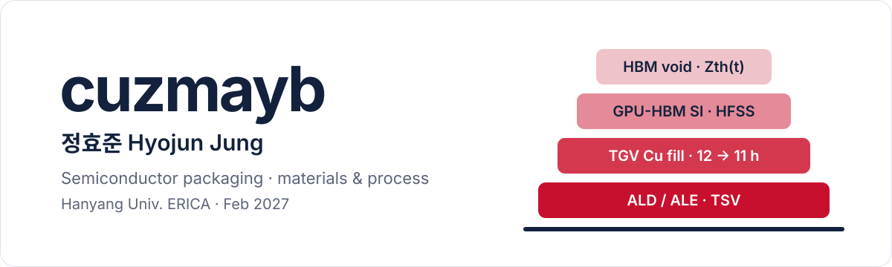

HBM·TSV·TGV 같은 반도체 패키징 공정 문제를 실험과 계산으로 풀고, 조건과 숫자를 기록합니다. 
I work on semiconductor packaging process problems (HBM, TSV, TGV) with experiments and calculations, and write down the conditions and the numbers.

  

**정효준 (Hyojun Jung)** · 한양대 ERICA 재료화학공학 4학년, 2027년 2월 졸업 예정

## 프로젝트

- **[TGV Cu 전해도금 공정 최적화](https://cuzmayb.vercel.app/projects/tgv-copper-filling)**: 초음파 교반을 더해 void 없이 채우는 조건을 찾고, 도금 시간을 12시간에서 11시간으로 줄였습니다.
- **[HBM Void 검사](https://cuzmayb.vercel.app/projects/hbm-void-thermal)**: 과도 열응답 Zth(t)로 본딩층 void를 찾는 1D 모델입니다. 산포가 없을 때 면적 2.5 %부터 90 % 이상 검출합니다(합성 데이터).
- **[소재 AI 해커톤](https://cuzmayb.vercel.app/projects/materials-ai-hackathon)**: 화학식과 온도만으로 고체전해질 이온전도도를 예측해 예선 Private 10위 / 34팀으로 본선에 올랐습니다.

전체 목록: [cuzmayb.vercel.app/projects](https://cuzmayb.vercel.app/projects)

## 지금 하는 일 (2026년 11월)

GPU와 HBM 사이에 냉각 수로를 두면 인터포저 신호선이 얼마나 나빠지는지 HFSS로 비교하고 있습니다. 물이 없는 기준선까지 풀었습니다.

이 계정의 공개 저장소는 사이트 코드([cuzmayb-site](https://github.com/cuzmayb/cuzmayb-site)) 하나입니다. 프로젝트 내용과 출처는 사이트에 있습니다.

## 연락

[사이트](https://cuzmayb.vercel.app) · [English](https://cuzmayb.vercel.app/en) · [이력서](https://cuzmayb.vercel.app/resume) · [LinkedIn](https://www.linkedin.com/in/cuzmayb) · cuzmayb@gmail.com

<!--
owner: cuzmayb. last reviewed: 2026-11-24.
review when: 새 프로젝트를 사이트에 올릴 때, 공모전 결과 발표, HFSS 비교 완료, 졸업이나 취업.
-->
